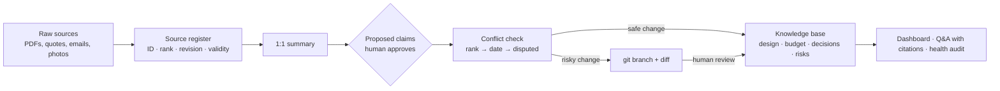
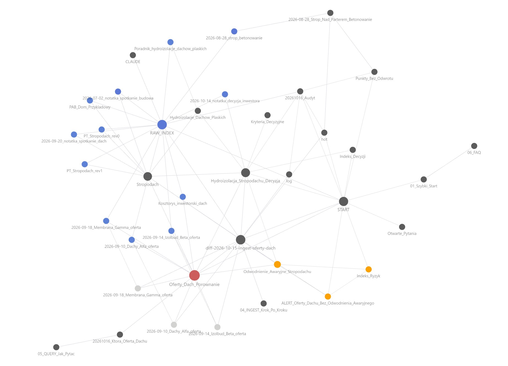
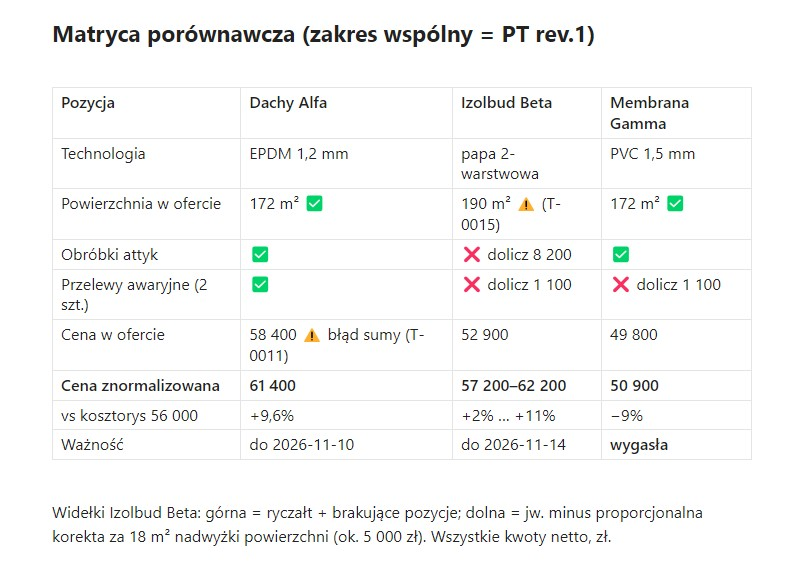

# Source-Ranked Second Brain

[](LICENSE)


**English** · [Polski](README.pl.md)

**An AI-assisted knowledge system that turns hundreds of conflicting documents into traceable, source-ranked facts — with a human approving every change.**

### What it solves

- **"Which version is true?"** Every fact carries its source, its rank (a signed design outranks a phone call) and an expiry date, so conflicts are resolved by rule, not by memory.
- **AI that makes things up.** The agent answers only from approved claims, cites an ID on every sentence and marks gaps as `UNVERIFIED` instead of guessing.
- **Silent changes.** Risky edits (overriding a fact, budget changes, final decisions) land on a separate git branch with a diff for human review. Nothing is deleted; history is kept.





> This repository is a **template with a fully fictional demo** ("Dom Przykładowy" — *Example House*). It shows the method; no real project data is included. The vault content and agent rules are in Polish; the method itself is language-agnostic.

---

## Case study: a residential project run developer-style

*Field-tested on a live residential build: several hundred source documents, over a thousand claims. Anonymized; every example below comes from the base.*

**The problem.** Designs in multiple revisions, many contractors quoting different scopes, inspector reports and plenty of verbal opinions on site. The real risk is not a missing document. It is a number in one document that silently contradicts another.

**1. Numbers nobody noticed**
- Heat-pump quotes normalized to the design heat load at −20 °C: of about 20 models offered, only 4 had a confirmed margin. One sold as "12 kW" delivers about 30% less at design temperature, by the manufacturer's own curve.
- The party wall between units meets the acoustic requirement with a 2 dB margin. A substitute wall proposed in one quote loses an estimated 3–4 dB by the mass law. Once people move in, that cannot be fixed.

**2. What must happen before work gets covered up**
- The column reinforcement drawings ignored the zone where the slab beam enters the column. This was flagged as critical during slab formwork. When a reply addressed a different alert, the agent kept this one open.
- A Ø250 mm flue was planned through a Ø250 mm slab opening, leaving no room for insulation or a fire sleeve. Caught by reconciling two separate messages while the slab was still in formwork.
- The main ventilation ducts need 310–350 mm; the ceiling void is 155 mm. The clash was predicted before any HVAC drawings existed and confirmed when they arrived. The deadline was set before the floor screeds.

**3. Written confirmation, not opinions**
- Acoustic stair connectors: the contractor said "no problem", another tradesperson raised two technical objections, and the inspector's photos showed a connector type that is not in the design. Sent to the structural engineer for a written answer.
- An inspector's report accepted the ground-floor columns while the attached photos showed upper-floor ones. Marked `UNVERIFIED` and sent back as a question. Neither version was silently "corrected".

**4. Deadlines**
- The contract schedule put final acceptance three days *before* readiness for acceptance. Those dates drive penalties, retention release and the start of the warranty. Flagged for written correction ahead of the deadline.

**And on itself.** A health audit found 109 claims marked FACT that rested only on conversations and notes. The system caught its own confidence inflation and listed them for review.

### See it in action (fictional demo)

- [Which roof quote is best?](14_AI_Analizy/20261016_Ktora_Oferta_Dachu.md): an answer with a citation on every sentence, warnings first.
- [Roof quote comparison](06_Budzet_i_Koszty/Oferty_Dach_Porownanie.md): three quotes normalized to the design scope; the price ranking changes.
- [Flat roof claims](03_Projekt/Architektura/Stropodach.md): a rank-based override, a `disputed` pair and a `stale` claim from a superseded revision.
- [Health audit report](17_Raporty/Audyty_Cykliczne/20261016_Audyt.md): what the periodic LINT finds.



## How it works

The unit of knowledge is not a file or a note but a **claim**: one verifiable sentence that carries its source, the rank of that source and the date until which it holds.

The agent (Claude Code) maintains the base according to the rules in [`CLAUDE.md`](CLAUDE.md): it registers sources, extracts claims, detects conflicts and resolves them by source rank. Whatever it cannot resolve goes back to a human, with a deadline and a named decision-maker.

### Key ideas

1. **Source rank sets a confidence ceiling.** Eight ranks, from verified reality (dated photo, site log) through designs, written confirmations and contracts, down to meeting notes and AI analyses. A verbal agreement never becomes a FACT on its own; an AI analysis is never a source of fact.
2. **Supersede, never delete.** A losing claim is marked `superseded → T-NNNN` and stays visible.
3. **Frozen reality.** After a point of no return (e.g. concrete poured), a new design revision does not overwrite the record — it raises a design-vs-reality alert.
4. **Change classes + branch + diff.** Safe changes are written immediately; risky ones go to an `agent/*` branch for `/diff-review`.
5. **Claims shown before writing.** On every ingest the agent stops and lists what it intends to record. This is where model errors get caught.
6. **Periodic health audit (LINT).** Expired quotes, claims based on superseded revisions, stale disputes, FACTs resting on weak sources, decisions missing approvals.
7. **Portable vs project knowledge.** How a technology works (`04_Technologie/`) is kept apart from the parameters of this specific project (`03_Projekt/`, `05_Instalacje/`).
8. **Answers with citations.** `/query` replies only from `active`/`frozen` claims: warnings first, an ID on every sentence, then gaps and the questions an inspector would ask.

### What a claim looks like

```
- [T-0004] {status: active} {pewność: FAKT} {as-of: 2026-08-20} {ważne-do: PT-rev-next} {wymaga: —}
  Roof insulation is EPS with an average thickness of 25 cm and a 2% slope layer.
  Źródło: [[raw/projekt/PT_Stropodach_rev1.md]] (S-002) dwg K-07 | ranga: 3 | rewizja: PT rev.1
```

(`pewność` = confidence: FACT / HYPOTHESIS / RECOMMENDATION / UNVERIFIED; `ważne-do` = valid until; `wymaga` = requires; `Źródło` = source; `ranga` = source rank.)

## Where this applies beyond construction

- **Due diligence** — reconciling a data room where financials, contracts and management statements disagree.
- **Compliance and audit** — keeping each control statement tied to the evidence and document version behind it.
- **Project and technical documentation** — tracking which spec revision is current and what it changed downstream.
- **Legal matters and disputes** — separating documented facts from assertions made in correspondence, on a clear timeline.
- **Tenders and quote comparison** — normalizing offers to a common scope before comparing prices.
- **Company knowledge onboarding** — giving new team members answers that point to sources rather than to whoever remembers.

## What this demonstrates

- **Information architecture** — a folder and file model that separates sources, summaries, claims, decisions, risks and reports.
- **Provenance and data reliability** — source ranking, confidence ceilings, revision tracking and expiry.
- **Human-in-the-loop AI** — the model proposes, a person approves; risky changes are reviewable and reversible through git.
- **Risk and decision management** — risk cards, time-boxed alerts, decision cards with explicit approvals.
- **Privacy by design** — a template with fictional data instead of a sanitized copy of a real base (see the [FAQ](docs/06_FAQ.md)).

## Getting started

```bash
git clone https://github.com/andrzej-osial/source-ranked-second-brain.git my-knowledge-base
cd my-knowledge-base
claude          # Claude Code reads CLAUDE.md automatically
```

1. Open the folder in [Obsidian](https://obsidian.md) as a vault; start at `00_Dashboard/START.md`.
2. Try the demo: `/query Która oferta na dach jest najkorzystniejsza?` ("Which roof quote is best?"), `/lint`, `/diff-review`.
3. Adapting it to your own project: [docs/01_Szybki_Start.md](docs/01_Szybki_Start.md) (Polish). Read the [privacy FAQ](docs/06_FAQ.md) before adding real documents.

### Commands (`.claude/commands/`)

| Command | What it does |
|---|---|
| `/ingest <file>` | registers a source, summarizes it, proposes claims, detects conflicts |
| `/rewizja <file>` | brings in a new design revision, marks old claims stale, detects mismatches with frozen reality |
| `/query <question>` | answers only from claims, with IDs and warnings |
| `/freeze <point>` | freezes the as-built state after a point of no return |
| `/diff-review` | human review of risky changes before merge |
| `/lint` | health audit of the base |
| `/handoff`, `/pickup` | save and resume a session without reloading the full history |

### Demo contents

| Mechanism | File |
|---|---|
| Source register with revisions and validity | [raw/RAW_INDEX.md](raw/RAW_INDEX.md) |
| Three quotes: scope normalization, sum error, area mismatch | [06_Budzet_i_Koszty/Oferty_Dach_Porownanie.md](06_Budzet_i_Koszty/Oferty_Dach_Porownanie.md) |
| Rank-based override, a `disputed` pair, a `stale` claim from a superseded revision | [03_Projekt/Architektura/Stropodach.md](03_Projekt/Architektura/Stropodach.md) |
| `frozen` as-built claim | [13_Dziennik_Budowy/2026-08-28_Strop_Nad_Parterem_Betonowanie.md](13_Dziennik_Budowy/2026-08-28_Strop_Nad_Parterem_Betonowanie.md) |
| Decision card with approvals | [10_Decyzje/Hydroizolacja_Stropodachu_Decyzja.md](10_Decyzje/Hydroizolacja_Stropodachu_Decyzja.md) |
| Risk + alert | [09_Ryzyka_i_Problemy/Indeks_Ryzyk.md](09_Ryzyka_i_Problemy/Indeks_Ryzyk.md) |
| Diff awaiting review | [_ops/diff-2026-10-15-ingest-oferty-dach.md](_ops/diff-2026-10-15-ingest-oferty-dach.md) |
| Health audit report | [17_Raporty/Audyty_Cykliczne/20261016_Audyt.md](17_Raporty/Audyty_Cykliczne/20261016_Audyt.md) |
| Answer with citations | [14_AI_Analizy/20261016_Ktora_Oferta_Dachu.md](14_AI_Analizy/20261016_Ktora_Oferta_Dachu.md) |

### Directory layout

```
00_Dashboard/         start page, today's state, open questions
01–02                 strategy, plot & permits
03_Projekt/           design and coordination
04_Technologie/       portable knowledge
05_Instalacje/        this building's MEP systems
06_Budzet_i_Koszty/   quotes, comparisons
07–08                 contractors & people, schedule, points of no return
09_Ryzyka_i_Problemy/ risks + alerts
10_Decyzje/           decision cards
11–13                 documents, communication, site log
14_AI_Analizy/        ad-hoc analyses (lowest rank)
15_Knowledge_Base/    1:1 source summaries
16–19                 checklists, periodic reports, glossary, archive
_ops/  docs/  raw/    diffs for review, method docs, read-only sources
```

## Work with me

I help teams and independent specialists set up knowledge and project systems where AI does the heavy lifting and people stay in control. Typical engagements: a workshop or hands-on rollout of an AI-assisted knowledge base for a team, an audit of existing documentation and decision records, and configuring Claude Code + Obsidian for a specific workflow.

**Andrzej Osial** · [andrzej.osial@aicentury.pl](mailto:andrzej.osial@aicentury.pl) · [LinkedIn](https://www.linkedin.com/in/andrzej-osial)

## License

[MIT](LICENSE)
