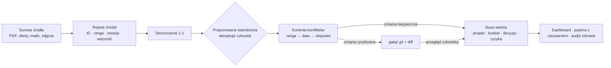
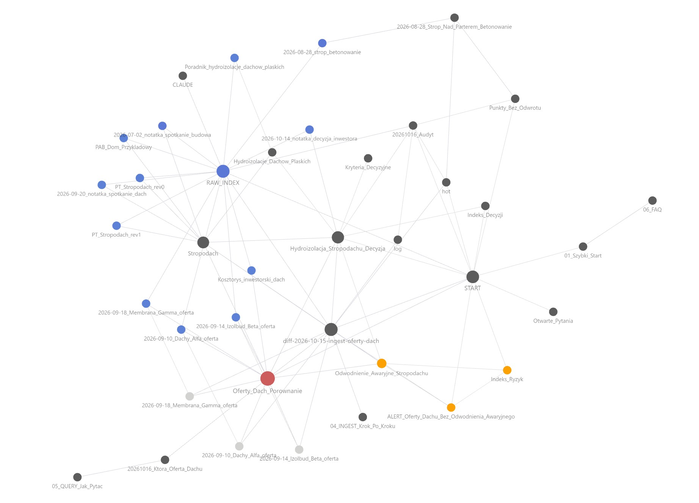
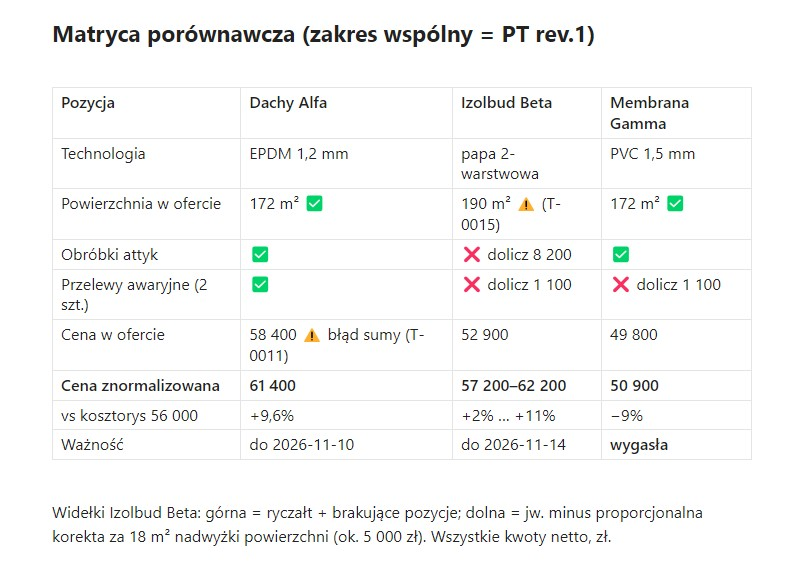

# Second Brain z rangą źródeł

[](LICENSE)


[English](README.md) · **Polski**

**System wiedzy wspierany przez AI, który zamienia setki sprzecznych dokumentów w możliwe do prześledzenia fakty z rangą źródła — a każdą zmianę zatwierdza człowiek.**

### Co rozwiązuje

- **„Która wersja jest prawdziwa?"** Każdy fakt ma źródło, rangę (podpisany projekt wygrywa z rozmową telefoniczną) i datę ważności — konflikty rozstrzyga reguła, nie pamięć.
- **AI, które zmyśla.** Agent odpowiada wyłącznie z zatwierdzonych twierdzeń, przy każdym zdaniu podaje ID, a luki oznacza jako `UNVERIFIED` zamiast zgadywać.
- **Ciche zmiany.** Ryzykowne edycje (nadpisanie faktu, budżet, decyzje ostateczne) trafiają na osobną gałąź git z diffem do przeglądu — nic nie jest usuwane, historia zostaje.





> Repozytorium to **szablon z całkowicie fikcyjnym przykładem** („Dom Przykładowy"). Pokazuje metodę; nie zawiera danych prawdziwego projektu.

---

## Studium przypadku: inwestycja mieszkaniowa prowadzona jak projekt deweloperski

*Sprawdzone na trwającej budowie: kilkaset dokumentów źródłowych, ponad tysiąc twierdzeń. Zanonimizowane; każdy przykład pochodzi z bazy.*

**Problem.** Projekty w wielu rewizjach, wielu wykonawców wyceniających różne zakresy, raporty inspektora i mnóstwo ustnych opinii na budowie. Prawdziwym ryzykiem nie jest brakujący dokument, tylko liczba w jednym dokumencie, która po cichu przeczy innemu.

**1. Liczby, których nikt nie zauważył**
- Oferty pomp ciepła sprowadzone do projektowego obciążenia cieplnego przy −20 °C: z ok. 20 modeli tylko 4 miały potwierdzony zapas. Model sprzedawany jako „12 kW" w temperaturze projektowej daje ok. 30% mniej, według krzywej samego producenta.
- Ściana międzylokalowa spełnia wymaganie akustyczne z zapasem 2 dB. Zamiennik z jednej z ofert według prawa masy traci szacunkowo 3–4 dB. Po zasiedleniu nie da się tego naprawić.

**2. Co musi się wydarzyć przed robotami zakrywającymi**
- Rysunki zbrojenia słupów pomijały strefę, w której belka stropu wchodzi w słup. System oznaczył to jako krytyczne w trakcie szalowania stropu. Gdy przyszła odpowiedź dotycząca innego alertu, agent ten utrzymał otwarty.
- Rurę dymową Ø250 mm zaplanowano w otworze stropowym Ø250 mm, bez miejsca na izolację i tuleję ppoż. Wychwycone przez zestawienie dwóch osobnych wiadomości, gdy strop był jeszcze w szalunku.
- Główne kanały wentylacji potrzebują 310–350 mm, a w przestrzeni nad sufitem jest 155 mm. Kolizję przewidziano, zanim powstał projekt instalacji, a projekt ją potwierdził. Termin rozwiązania: przed wylewkami.

**3. Pisemne potwierdzenie zamiast opinii**
- Akustyczne łączniki schodów: wykonawca mówił „nie ma problemu", inny fachowiec zgłosił dwa zarzuty techniczne, a na zdjęciach inspektora widać typ, którego nie ma w projekcie. Sprawa trafiła do konstruktora po odpowiedź na piśmie.
- Raport inspektora odbierał słupy parteru, a dołączone zdjęcia pokazywały słupy piętra. System oznaczył to jako `UNVERIFIED` i odesłał jako pytanie. Żadnej wersji nie „poprawiono" po cichu.

**4. Terminy**
- Harmonogram umowy stawiał odbiór końcowy trzy dni *przed* gotowością do odbioru. Od tych dat zależą kary, zwrot kaucji i start gwarancji. System zgłosił to do pisemnej korekty przed terminem.

**I o sobie samym.** Audyt zdrowia bazy znalazł 109 twierdzeń oznaczonych jako FAKT, opartych wyłącznie na rozmowach i notatkach. System sam wychwycił zawyżoną pewność i wystawił je do przeglądu.

### Zobacz w działaniu (fikcyjne demo)

- [Która oferta na dach jest najkorzystniejsza?](14_AI_Analizy/20261016_Ktora_Oferta_Dachu.md) — odpowiedź z cytowaniem przy każdym zdaniu, ostrzeżenia na początku.
- [Porównanie ofert na dach](06_Budzet_i_Koszty/Oferty_Dach_Porownanie.md) — trzy oferty sprowadzone do zakresu projektu; kolejność cenowa się zmienia.
- [Twierdzenia o stropodachu](03_Projekt/Architektura/Stropodach.md) — rozstrzygnięcie rangą, para `disputed` i twierdzenie `stale` z zastąpionej rewizji.
- [Raport audytu](17_Raporty/Audyty_Cykliczne/20261016_Audyt.md) — co znajduje cykliczny LINT.



## Jak to działa

Jednostką wiedzy nie jest plik ani notatka, tylko **twierdzenie**: jedno sprawdzalne zdanie, które niesie swoje źródło, rangę tego źródła i datę, do której obowiązuje.

Agent (Claude Code) prowadzi bazę według reguł z [`CLAUDE.md`](CLAUDE.md): rejestruje źródła, wyciąga twierdzenia, wykrywa konflikty i rozstrzyga je według rangi źródła. Czego nie umie rozstrzygnąć, oddaje człowiekowi — z terminem i wskazaniem, kto decyduje.

### Kluczowe idee

1. **Ranga źródła wyznacza sufit pewności.** Osiem rang: od stanu faktycznego (zdjęcie z datą, dziennik budowy), przez projekty, pisemne potwierdzenia i umowy, po notatki ze spotkań i analizy AI. Ustalenie ustne nigdy samo nie staje się FAKTEM; analiza AI nigdy nie jest źródłem faktu.
2. **Zastępowanie zamiast usuwania.** Przegrane twierdzenie dostaje `superseded → T-NNNN` i zostaje widoczne.
3. **Zamrożony stan faktyczny.** Po punkcie bez odwrotu (np. betonowanie) nowa rewizja projektu nie nadpisuje zapisu — tworzy alert o rozjeździe projektu z rzeczywistością.
4. **Klasy zmian + gałąź + diff.** Zmiany bezpieczne zapisują się od razu; ryzykowne trafiają na gałąź `agent/*` do `/diff-review`.
5. **Lista twierdzeń przed zapisem.** Przy każdym ingeście agent zatrzymuje się i pokazuje, co chce zapisać. Tu łapie się błędy modelu.
6. **Cykliczny audyt (LINT).** Wygasłe oferty, twierdzenia z zastąpionych rewizji, przeterminowane spory, FAKT na słabym źródle, decyzje bez akceptacji.
7. **Wiedza przenośna osobno od wiedzy o projekcie.** Jak działa technologia (`04_Technologie/`) — osobno od parametrów konkretnego obiektu (`03_Projekt/`, `05_Instalacje/`).
8. **Odpowiedzi z cytowaniem.** `/query` odpowiada tylko z twierdzeń `active`/`frozen`: najpierw ostrzeżenia, ID przy każdym zdaniu, na końcu luki i pytania, które zadałby inspektor.

### Jak wygląda twierdzenie

```
- [T-0004] {status: active} {pewność: FAKT} {as-of: 2026-08-20} {ważne-do: PT-rev-next} {wymaga: —}
  Ocieplenie stropodachu to EPS dachowy o średniej grubości 25 cm z warstwą spadkową 2%.
  Źródło: [[raw/projekt/PT_Stropodach_rev1.md]] (S-002) rys. K-07 | ranga: 3 | rewizja: PT rev.1
```

## Gdzie to działa poza budową

- **Due diligence** — uzgadnianie data roomu, w którym finanse, umowy i deklaracje zarządu sobie przeczą.
- **Compliance i audyt** — każde stwierdzenie o kontroli powiązane z dowodem i wersją dokumentu, na której się opiera.
- **Zarządzanie projektami i dokumentacją techniczną** — która rewizja specyfikacji obowiązuje i co zmieniła dalej.
- **Sprawy prawne i spory** — oddzielenie udokumentowanych faktów od twierdzeń z korespondencji, z czytelną osią czasu.
- **Przetargi i porównanie ofert** — sprowadzenie ofert do wspólnego zakresu, zanim porówna się ceny.
- **Onboarding wiedzy w firmie** — nowe osoby dostają odpowiedzi wskazujące źródła, a nie osobę, która „pamięta".

## Co pokazuje ten projekt

- **Projektowanie architektury informacji** — model katalogów i plików oddzielający źródła, streszczenia, twierdzenia, decyzje, ryzyka i raporty.
- **Proweniencja i wiarygodność danych** — ranga źródeł, sufit pewności, śledzenie rewizji i ważności.
- **AI z człowiekiem w pętli** — model proponuje, człowiek zatwierdza; ryzykowne zmiany są przeglądalne i odwracalne dzięki git.
- **Zarządzanie ryzykiem i decyzjami** — karty ryzyk, alerty z terminem, karty decyzji z jawnymi akceptacjami.
- **Ochrona prywatności** — szablon z fikcyjnymi danymi zamiast oczyszczonej kopii prawdziwej bazy (patrz [FAQ](docs/06_FAQ.md)).

## Jak zacząć

```bash
git clone https://github.com/andrzej-osial/source-ranked-second-brain.git moja-baza-wiedzy
cd moja-baza-wiedzy
claude          # Claude Code czyta CLAUDE.md automatycznie
```

1. Otwórz folder w [Obsidian](https://obsidian.md) jako vault, zacznij od `00_Dashboard/START.md`.
2. Wypróbuj demo: `/query Która oferta na dach jest najkorzystniejsza?`, `/lint`, `/diff-review`.
3. Przejście na własny projekt: [docs/01_Szybki_Start.md](docs/01_Szybki_Start.md). Przeczytaj [FAQ o prywatności](docs/06_FAQ.md), zanim dodasz prawdziwe dokumenty.

### Komendy (`.claude/commands/`)

| Komenda | Co robi |
|---|---|
| `/ingest <plik>` | rejestruje źródło, streszcza, proponuje twierdzenia, wykrywa konflikty |
| `/rewizja <plik>` | wprowadza nową rewizję projektu, wygasza stare twierdzenia, wykrywa rozjazdy ze stanem zamrożonym |
| `/query <pytanie>` | odpowiedź tylko z twierdzeń, z ID i ostrzeżeniami |
| `/freeze <punkt>` | zamraża stan faktyczny po punkcie bez odwrotu |
| `/diff-review` | przegląd ryzykownych zmian przez człowieka przed merge |
| `/lint` | audyt zdrowia bazy |
| `/handoff`, `/pickup` | zapis i wznowienie sesji bez ładowania całej historii |

### Zawartość demo

| Mechanizm | Plik |
|---|---|
| Rejestr źródeł z rewizjami i ważnością | [raw/RAW_INDEX.md](raw/RAW_INDEX.md) |
| Trzy oferty: normalizacja zakresu, błąd sumy, rozbieżna powierzchnia | [06_Budzet_i_Koszty/Oferty_Dach_Porownanie.md](06_Budzet_i_Koszty/Oferty_Dach_Porownanie.md) |
| Rozstrzygnięcie rangą, para `disputed`, twierdzenie `stale` z zastąpionej rewizji | [03_Projekt/Architektura/Stropodach.md](03_Projekt/Architektura/Stropodach.md) |
| Twierdzenie `frozen` | [13_Dziennik_Budowy/2026-08-28_Strop_Nad_Parterem_Betonowanie.md](13_Dziennik_Budowy/2026-08-28_Strop_Nad_Parterem_Betonowanie.md) |
| Karta decyzji z akceptacjami | [10_Decyzje/Hydroizolacja_Stropodachu_Decyzja.md](10_Decyzje/Hydroizolacja_Stropodachu_Decyzja.md) |
| Ryzyko + alert | [09_Ryzyka_i_Problemy/Indeks_Ryzyk.md](09_Ryzyka_i_Problemy/Indeks_Ryzyk.md) |
| Diff do przeglądu | [_ops/diff-2026-10-15-ingest-oferty-dach.md](_ops/diff-2026-10-15-ingest-oferty-dach.md) |
| Raport audytu | [17_Raporty/Audyty_Cykliczne/20261016_Audyt.md](17_Raporty/Audyty_Cykliczne/20261016_Audyt.md) |
| Odpowiedź z cytowaniem | [14_AI_Analizy/20261016_Ktora_Oferta_Dachu.md](14_AI_Analizy/20261016_Ktora_Oferta_Dachu.md) |

### Struktura katalogów

```
00_Dashboard/        start, stan na dziś, otwarte pytania
01–02                strategia, działka i formalności
03_Projekt/          projekt i koordynacja
04_Technologie/      wiedza przenośna
05_Instalacje/       instalacje tego obiektu
06_Budzet_i_Koszty/  oferty, porównania
07–08                wykonawcy i osoby, harmonogram, punkty bez odwrotu
09_Ryzyka_i_Problemy/ ryzyka + alerty
10_Decyzje/          karty decyzji
11–13                dokumenty, komunikacja, dziennik budowy
14_AI_Analizy/       analizy ad hoc (najniższa ranga)
15_Knowledge_Base/   streszczenia 1:1 źródeł
16–19                checklisty, raporty cykliczne, słownik, archiwum
_ops/  docs/  raw/   diffy do przeglądu, dokumentacja metody, źródła tylko do odczytu
```

## Współpraca

Pomagam zespołom i niezależnym specjalistom budować systemy wiedzy i zarządzania projektami, w których AI wykonuje żmudną pracę, a ludzie zachowują kontrolę. Typowe formy: warsztat lub wdrożenie bazy wiedzy z AI w zespole, audyt istniejącej dokumentacji i rejestru decyzji, konfiguracja Claude Code + Obsidian pod konkretny proces.

**Andrzej Osial** · [andrzej.osial@aicentury.pl](mailto:andrzej.osial@aicentury.pl) · [LinkedIn](https://www.linkedin.com/in/andrzej-osial)

## Licencja

[MIT](LICENSE)
