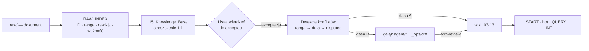

# Architektura

## Warstwy

| Warstwa | Gdzie | Kto pisze | Zasada |
|---|---|---|---|
| Źródła | `raw/` | człowiek | tylko odczyt dla agenta |
| Rejestr źródeł | `raw/RAW_INDEX.md` | agent (klasa A) | każdy plik ma ID, rangę, rewizję, ważność, status |
| Streszczenia | `15_Knowledge_Base/` | agent (klasa A) | 1 plik raw → 1 plik KB, ta sama nazwa |
| Twierdzenia | sekcja `## Twierdzenia` w plikach wiki | agent, po akceptacji listy | atomowe, z ID, źródłem i rangą |
| Wiki | `03_`…`13_` | agent | routing wg rodzaju wiedzy |
| Artefakty | `00_Dashboard/`, `14_AI_Analizy/`, `17_Raporty/` | agent | ranga 8 — nigdy źródło FAKT |
| Operacje | `_ops/diff-*.md`, gałęzie `agent/*` | agent | klasa B czeka na człowieka |

## Przepływ

## Routing wiedzy

- **Przenośna** (jak działa technologia) → `04_Technologie/`.
- **O tym obiekcie** (parametry, trasy, rzędne) → `03_Projekt/`, `05_Instalacje/`.
- **Pieniądze** → `06_Budzet_i_Koszty/` (zawsze klasa B).
- **Stan faktyczny** → `13_Dziennik_Budowy/` (ranga 1, `frozen`).
- **Ryzyka** → `09_Ryzyka_i_Problemy/` + alert dla HIGH/CRITICAL.

## Bezpieczniki

- `.claude/settings.json` blokuje agentowi edycję plików w podkatalogach `raw/`.
- Klasa B nigdy nie trafia na `main` bez `/diff-review`.
- Twierdzeń się nie usuwa — tylko `superseded → T-…`. Historia zostaje w pliku i w git.
