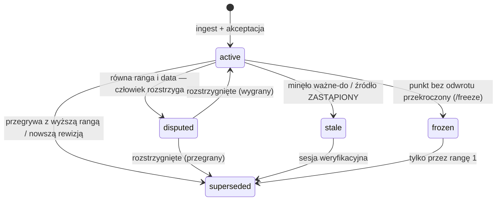

# Cykl życia twierdzenia

## Anatomia

```
- [T-0004] {status: active} {pewność: FAKT} {as-of: 2026-08-20} {ważne-do: PT-rev-next} {wymaga: —}
  Ocieplenie stropodachu to EPS dachowy o średniej grubości 25 cm z warstwą spadkową 2%.
  Źródło: [[raw/projekt/PT_Stropodach_rev1.md]] (S-002) rys. K-07 | ranga: 3 | rewizja: PT rev.1
```

- **Jedno zdanie, jeden fakt.** Da się je sprawdzić w źródle.
- **Pewność ma sufit wyznaczony rangą.** Notatka ze spotkania (ranga 7) nigdy nie da FAKTU o parametrze technicznym.
- **`as-of`** to data stanu rzeczy, nie data wpisu.
- **`ważne-do`** mówi, kiedy twierdzenie samo się zestarzeje (oferta, rewizja projektu).

## Statusy



## Przykłady w demo

| Mechanizm | Gdzie | Co się stało |
|---|---|---|
| Wygrywa ranga | T-0001 → T-0004 | notatka ze spotkania (7) przegrała z projektem technicznym (3) |
| Spór | T-0006 vs T-0007 | dwie wypowiedzi na tym samym spotkaniu — rozstrzyga projektantka |
| Nowa rewizja | T-0008 `stale` | PT rev.0 zastąpiony przez rev.1 |
| Wygasła oferta | T-0013 `stale` | LINT po dacie ważności |
| Stan zamrożony | T-0030 `frozen` | strop zabetonowany — projekt już go nie zmieni bez alertu |
| Wyjątek decyzyjny | T-0025 FAKT na randze 7 | inwestor sam opisał swoją decyzję |
| Wyprowadzenie | T-0016 | normalizacja cen z T-0010, T-0012, T-0013 — ranga 8 |
| Niepewne | T-0009 `UNVERIFIED` | wpisano, co sprawdzić i u kogo |

## Czego nigdy nie robimy

- Nie usuwamy twierdzeń — przegrane zostają z adnotacją `superseded → T-…`.
- Nie przepisujemy twierdzeń `stale` w tej samej sesji, w której je wygaszamy.
- Nie „poprawiamy" stanu `frozen` na podstawie projektu — robimy alert.
